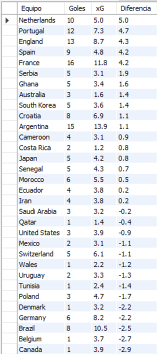

# Misión 5 · La lotería del gol (xG)
**Nivel 2 · Interrogatorio** · Herramientas: `SUM`, `GROUP BY`, `ROUND`, `ORDER BY` con expresiones

> Devi: "Hay equipos que meten todo lo que tiran y otros que no la ponen ni a propósito. ¿Quién tuvo más suerte (o más puntería) de la esperada?"

## La pregunta
Para cada selección, muestra los goles reales, el xG total (goles esperados) y la diferencia entre ambos, ordenada de mayor a menor diferencia. Solo cuenta el tiempo de juego, sin la tanda de penales.

El **xG** es la probabilidad de que un tiro termine en gol según dónde y cómo se hizo: un tiro con xG 0.76 casi siempre es gol, y uno con 0.02 casi nunca. Al sumar el xG de todos los tiros de un equipo se obtiene cuántos goles "debería" haber marcado.

## La consulta
```sql
USE mundial2022;

SELECT eq.nombre AS Equipo,
       SUM(t.es_gol) AS Goles,
       ROUND(SUM(t.xg), 1) AS xG,
       ROUND(SUM(t.es_gol) - SUM(t.xg), 1) AS Diferencia
FROM tiros t
INNER JOIN eventos ev ON t.evento_id = ev.evento_id
INNER JOIN equipos eq ON eq.equipo_id = ev.equipo_id
WHERE ev.periodo <= 4
GROUP BY eq.equipo_id, eq.nombre
ORDER BY SUM(t.es_gol) - SUM(t.xg) DESC;
```

Archivo ejecutable: [`queries/05_la_loteria_del_gol.sql`](../../queries/05_la_loteria_del_gol.sql)

## El resultado
Devuelve las 32 selecciones. Aquí, los 5 extremos de cada lado:

| Equipo | Goles | xG | Diferencia |
|---|---:|---:|---:|
| Netherlands | 10 | 5.0 | 5.0 |
| Portugal | 12 | 7.3 | 4.7 |
| England | 13 | 8.7 | 4.3 |
| Spain | 9 | 4.8 | 4.2 |
| France | 16 | 11.8 | 4.2 |
| ... | | | |
| Denmark | 1 | 3.2 | -2.2 |
| Germany | 6 | 8.2 | -2.2 |
| Brazil | 8 | 10.5 | -2.5 |
| Belgium | 1 | 3.7 | -2.7 |
| Canada | 1 | 3.9 | -2.9 |



## Lo que descubrí
Países Bajos fue el equipo que más superó a su xG: 10 goles con un xG de 5.0 (+5.0), seguido de Portugal (+4.7) e Inglaterra (+4.3). En el otro extremo, Canadá y Bélgica marcaron un solo gol cada uno pese a un xG de 3.9 y 3.7, y junto con Alemania (6 goles con un xG de 8.2) quedaron eliminados en la fase de grupos. Argentina, la campeona, superó su xG de forma moderada: 15 goles frente a 13.9 (+1.1).

## Lo que aprendí de SQL
Cuando el `SELECT` mezcla funciones de agregación con columnas normales, esas columnas deben ir en el `GROUP BY`. Una columna decimal como `xg` se suma igual que un contador, y `ORDER BY` acepta expresiones además de alias. Comparar lo real con lo esperado (`SUM(es_gol) - SUM(xg)`) convierte un conteo en una medida de rendimiento.
