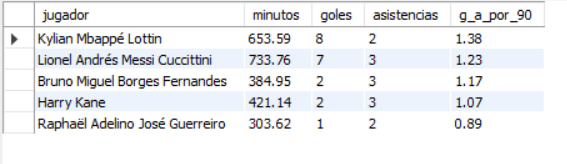

# Misión 9 · El duelo de las estrellas
**Nivel 3 · Resolución** · Herramientas: varias CTEs, `LEFT JOIN`, `COALESCE`, cálculo por 90 minutos

> Devi: "Messi o Mbappé... pero ¿y los demás? Quiero ver quién fue más decisivo contando también las asistencias y ajustando por los minutos jugados."

## La pregunta
Para los jugadores con al menos **300 minutos** jugados, calcula los **goles + asistencias por 90 minutos** y muestra el top 5. Cuenta solo el tiempo de juego (`periodo <= 4`): los goles son los de los tiros, las asistencias son los pases con `es_asistencia = 1` (se atribuyen a quien dio el pase) y los minutos salen de sumar los tramos de `alineacion_tramos`.

## La consulta
```sql
USE mundial2022;

WITH minutos_jugador AS (
    SELECT j.jugador_id,
           j.nombre AS jugador,
           SUM(at.hasta_min - at.desde_min) AS minutos
    FROM alineacion_tramos at
    JOIN jugadores j ON j.jugador_id = at.jugador_id
    GROUP BY j.jugador_id, j.nombre
    HAVING SUM(at.hasta_min - at.desde_min) >= 300
),
goles_jugador AS (
    SELECT e.jugador_id,
           SUM(t.es_gol) AS goles
    FROM tiros t
    JOIN eventos e ON t.evento_id = e.evento_id
    WHERE e.periodo <= 4
    GROUP BY e.jugador_id
),
asistencias_jugador AS (
    SELECT e.jugador_id,
           SUM(p.es_asistencia) AS asistencias
    FROM pases p
    JOIN eventos e ON p.evento_id = e.evento_id
    WHERE e.periodo <= 4
    GROUP BY e.jugador_id
)
SELECT m.jugador,
       m.minutos,
       COALESCE(g.goles, 0) AS goles,
       COALESCE(a.asistencias, 0) AS asistencias,
       ROUND(
           (COALESCE(g.goles, 0) + COALESCE(a.asistencias, 0)) * 90.0 / m.minutos,
           2
       ) AS g_a_por_90
FROM minutos_jugador m
LEFT JOIN goles_jugador g ON g.jugador_id = m.jugador_id
LEFT JOIN asistencias_jugador a ON a.jugador_id = m.jugador_id
ORDER BY g_a_por_90 DESC
LIMIT 5;
```

Archivo ejecutable: [`queries/09_el_duelo_de_las_estrellas.sql`](../../queries/09_el_duelo_de_las_estrellas.sql)

## El resultado



| jugador | minutos | goles | asistencias | g_a_por_90 |
|---|---:|---:|---:|---:|
| Kylian Mbappé Lottin | 653.59 | 8 | 2 | 1.38 |
| Lionel Andrés Messi Cuccittini | 733.76 | 7 | 3 | 1.23 |
| Bruno Miguel Borges Fernandes | 384.95 | 2 | 3 | 1.17 |
| Harry Kane | 421.14 | 2 | 3 | 1.07 |
| Raphaël Adelino José Guerreiro | 303.62 | 1 | 2 | 0.89 |

## Lo que descubrí
Mbappé y Messi terminaron con las mismas 10 intervenciones directas de gol (goles más asistencias), pero Mbappé las logró en unos 80 minutos menos, y por eso lidera con 1.38 frente a 1.23. Detrás aparecen Bruno Fernandes y Kane, que con solo 5 participaciones cada uno llegan al top 5 porque jugaron muchos menos minutos. El ranking premia la **eficiencia por minuto**, no el total: es una lista distinta de la de goleadores de la misión 8.

## Lo que aprendí de SQL
Una CTE es una tabla temporal con nombre que existe solo durante la consulta, y permite armar un problema por piezas: aquí, minutos, goles y asistencias por separado. Se parte de la CTE que tiene a todos los jugadores (los minutos) y se unen las otras con `LEFT JOIN`, para no perder a quien no marcó o no asistió. Esos huecos llegan como `NULL`, y `COALESCE(valor, 0)` los convierte en 0 antes de sumar.
