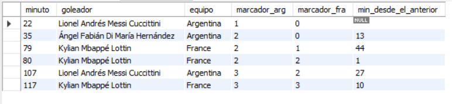

# Misión 10 · La final minuto a minuto
**Nivel 3 · Resolución** · Herramientas: CTEs encadenadas, `SUM() OVER`, `LAG`

> Devi: "Argentina contra Francia. Seis goles, una remontada y un final de locos. Quiero ver la final gol por gol, con el marcador que iba quedando y cuánto tardó cada gol desde el anterior."

## La pregunta
Muestra todos los goles de la final en orden cronológico, con el marcador acumulado de cada equipo después de cada gol y los minutos transcurridos desde el gol anterior (en el primero, `NULL`). Solo cuentan goles de tiros del tiempo de juego (`periodo <= 4`): la tanda de penales no entra.

## La consulta
```sql
USE mundial2022;

WITH goles_final AS (
    SELECT e.evento_id,
           e.minuto,
           j.nombre AS goleador,
           eq.nombre AS equipo
    FROM tiros t
    JOIN eventos e   ON t.evento_id = e.evento_id
    JOIN partidos p  ON e.partido_id = p.partido_id
    JOIN jugadores j ON e.jugador_id = j.jugador_id
    JOIN equipos eq  ON e.equipo_id = eq.equipo_id
    WHERE p.fase = 'Final'
      AND t.es_gol = 1
      AND e.periodo <= 4
),
marcador_cronologico AS (
    SELECT minuto,
           goleador,
           equipo,
           SUM(CASE WHEN equipo = 'Argentina' THEN 1 ELSE 0 END)
               OVER (ORDER BY minuto, evento_id) AS marcador_arg,
           SUM(CASE WHEN equipo = 'France' THEN 1 ELSE 0 END)
               OVER (ORDER BY minuto, evento_id) AS marcador_fra,
           minuto - LAG(minuto) OVER (ORDER BY minuto, evento_id) AS min_desde_el_anterior
    FROM goles_final
)
SELECT minuto,
       goleador,
       equipo,
       marcador_arg,
       marcador_fra,
       min_desde_el_anterior
FROM marcador_cronologico
ORDER BY minuto;
```

Archivo ejecutable: [`queries/10_la_final_minuto_a_minuto.sql`](../../queries/10_la_final_minuto_a_minuto.sql)

## El resultado



| minuto | goleador | equipo | marcador_arg | marcador_fra | min_desde_el_anterior |
|---:|---|---|---:|---:|---:|
| 22 | Lionel Andrés Messi Cuccittini | Argentina | 1 | 0 | NULL |
| 35 | Ángel Fabián Di María Hernández | Argentina | 2 | 0 | 13 |
| 79 | Kylian Mbappé Lottin | France | 2 | 1 | 44 |
| 80 | Kylian Mbappé Lottin | France | 2 | 2 | 1 |
| 107 | Lionel Andrés Messi Cuccittini | Argentina | 3 | 2 | 27 |
| 117 | Kylian Mbappé Lottin | France | 3 | 3 | 10 |

Los minutos son los de StatsBomb, que cuenta el minuto transcurrido desde 0: suelen ser uno menos que el minuto oficial (el penal de Messi figura en el 22, aunque se recuerda como el 23').

## Lo que descubrí
Argentina dominó la primera mitad y se puso 2–0 en el minuto 35. Después pasaron 44 minutos sin goles, el mayor silencio de la final, hasta que Mbappé empató el partido con dos goles en solo 1 minuto (79 y 80). La prórroga tuvo un gol por lado: Messi puso el 3–2 y Mbappé igualó 3–3 diez minutos después, completando sus tres goles de la noche. La final se decidió desde los once metros, donde Argentina convirtió 4 de 4 contra los 2 de 4 de France (misión 6).

## Lo que aprendí de SQL
Una función de ventana permite que cada fila "vea" a las anteriores sin colapsar el resultado. `SUM(CASE WHEN ... THEN 1 ELSE 0 END) OVER (ORDER BY ...)` va acumulando goles fila a fila y funciona como un marcador que se actualiza; `LAG(minuto)` trae el valor de la fila anterior para calcular el tiempo entre goles, y devuelve `NULL` en la primera fila, que no tiene anterior. Agregar un segundo criterio al `ORDER BY` de la ventana (`evento_id`) desempata si dos goles cayeran en el mismo minuto.
